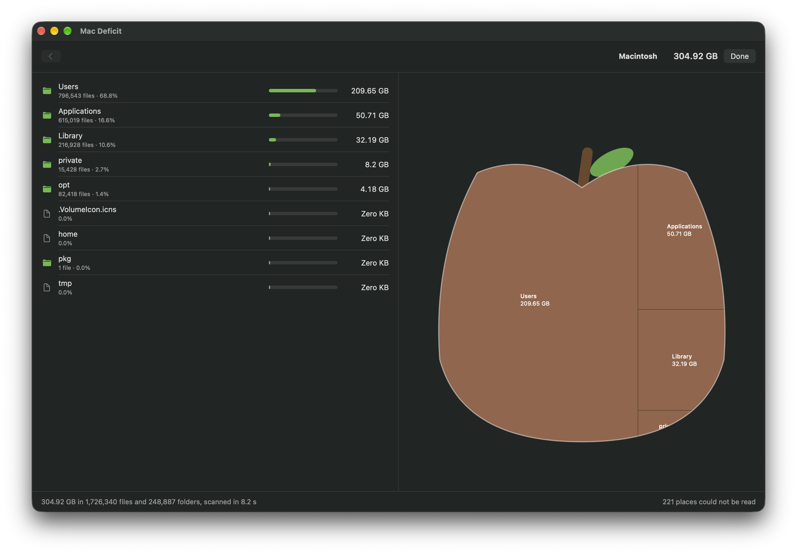

# Mac Deficit

***Where did my space go?*** A disk space analyzer for the Mac, by [RawData Studio](https://rawdata.cloud).

Mac Deficit shows you, the moment it opens, what is filling your Mac's drive, and lets you clear it safely. It is built for Macs on Apple Silicon, and for anyone who has watched a 256 GB or 512 GB drive fill up and found macOS's own Storage panel no help.

**In development** · No release date yet

> This repository is Mac Deficit's public home: screenshots, progress, and a place for your questions and ideas. The app's source code is private while we build it.

## The Idea
- **See it at once**: your main drive's health the moment the app opens, external drives a click away
- **The Apple Treemap**: your drive drawn as an apple, the cells filling it the folders and files eating its space. The bigger the cell, the bigger the deficit
- **Go deeper with a click**: into any folder, cell by cell, or as a sorted list
- **Act with confidence**: Reveal in Finder, or move to the Trash after you see exactly how much space it gives back. Nothing is deleted for good without asking
- **Private by design**: everything stays on your Mac. No accounts, no analytics, no telemetry

## What's Built So Far
- **Clear space safely**: right-click anything in the list or the apple and move it to the Trash, with its size shown first; the space it held leaves the totals at once. Changed your mind? Put Back returns it with one click
- **What your Mac needs is never offered**: macOS's own files and data, folders macOS protects for your privacy, your home folder and its standard folders. Mac Deficit says why
- **The Apple Treemap in the native app**: your drive drawn as an apple, round with a stem and a leaf and light falling across it, next to the list and always on the same folder. The apple is filled edge to edge with rounded cells, one for each folder and file, the biggest in the middle where the apple is widest, the apple's red running between them; the tiniest items share one cell, so every cell is big enough to point at. Folders take the colour of what fills them; hover for a cell's name, size and share, click a folder to go inside
- **One app, fully native**: the first interface, built while the scanner was proven, is retired; Mac Deficit is now the Swift app
- **A native Mac app**, rebuilt in Swift: pick a drive or any folder, watch the scan count up with a Cancel button, then browse the results folder by folder, largest first, with Reveal in Finder
- **Your drives as apples**: each drive shown as an apple filled from the bottom as far as it is used, so a full drive stands out from an empty one at a glance; with its real name, capacity and free space as Finder sees them, marked startup, internal, external or network
- A fast scan on every processor core: a whole internal drive of 1.9 million files and folders in about eight seconds, using about half a gigabyte of memory
- Sizes you can trust: the space files really take, hard-linked files counted once, shown in the same units as Finder
- Full Disk Access asked for, never assumed: the app explains why it helps and opens the right System Settings page, or carries on with limited access and lists every place it could not read
- If the app ever stops unexpectedly, it says so the next time it opens and shows you the report. The report, like the app's log, stays on your Mac, with your file names kept private
- VoiceOver throughout, checked screen by screen: the drives, the list, every cell of the apple read largest first, and every action

## From the Build

*The native app after a whole-drive scan: 305 GB in 1.7 million files, as a list and as an Apple Treemap. November 2026, work in progress.*

## Roadmap
| Phase | Status |
| --- | --- |
| Foundations | Complete · December 2025 |
| The Scanner | Complete · December 2025 |
| Seeing Your Drive | Complete · December 2025 |
| The Apple Treemap | In the native app · November 2026: a real-looking apple filled with cells, the biggest in the middle; the drives shown as apples |
| Audit and Overhaul | Complete · November 2026: scanner rebuilt (4× faster, half the memory), one native Mac app with its Apple Treemap, checked with VoiceOver, and its own icon: the drive apple, two thirds full |
| Clearing Space (Trash, Reveal in Finder) | Under way · November 2026: Reveal in Finder, Move to Trash with its size first, Put Back; clearing several things at once next |
| Polish and Release | Planned |

## Get Involved
- **Questions, ideas, or just want to say hi?** Start a thread in [Discussions](../../discussions).
- **Feedback on something you've seen?** Open an [issue](../../issues/new/choose).
- **Follow along** at [rawdata.cloud](https://rawdata.cloud).
