# Mac Deficit

***Where did my space go?*** A disk space analyzer for the Mac, by [RawData Studio](https://rawdata.cloud).

Mac Deficit shows you, the moment it opens, what is filling your Mac's drive, and lets you clear it safely. It is built for Macs on Apple Silicon, and for anyone who has watched a 256 GB or 512 GB drive fill up and found macOS's own Storage panel no help.

**In development** · No release date yet

> This repository is Mac Deficit's public home: screenshots, progress, and a place for your questions and ideas. The app's source code is private while we build it.

## The Idea
- **See it at once**: your main drive's health the moment the app opens, external drives a click away
- **The Apple Treemap**: your drive drawn as an apple, the cells filling it the folders and files eating its space. The bigger the cell, the bigger the deficit
- **Go deeper with a click**: into any folder, cell by cell, or as a sorted list
- **Act with confidence**: Reveal in Finder, or move to the Trash after you see exactly how much space it gives back. Nothing is deleted for good without asking
- **Private by design**: everything stays on your Mac. No accounts, no analytics, no telemetry

## What's Built So Far
- **Your drives as apples**: every drive on the Mac shown as an apple filled from the bottom as far as it is used, so a full drive stands out from an empty one at a glance; with its name, capacity and free space as Finder sees them. Plug in or eject a drive and the list follows. Folders you scanned lately are one click away
- **A fast scan on every processor core**: a whole internal drive of 1.8 million files and 240,000 folders in under nine seconds, using about half a gigabyte of memory. While it scans, the drive's apple fills and a card tells what the drive is, how it is connected, its format, and how fast it is reading and writing
- **Sizes you can trust**: the space files really take, with hard-linked files and copies that share their space counted once, in decimal units as Finder or binary units as Terminal. After a whole-drive scan, a button shows where the drive's used space went: what was found, macOS's own volumes, what could not be read, and the purgeable space macOS frees when it needs room
- **The Apple Treemap**: your drive drawn as an apple, round with a stem and a leaf and light falling across it, beside the list and always on the same folder. Rounded cells fill it edge to edge, one for each folder and file, the biggest in its body and the smallest toward the tip; folders take the colour of what fills them. Hover for a cell's name, size and share, click a folder to go inside
- **Find anything**: type a name and see every match below the folder you are in, largest first, with where each one is and the space they take together; pick a kind (folders, files, videos, documents and more), or a kind alone to see the largest of that kind anywhere on the drive
- **Clear space safely**: choose one item or several, in the list or the apple, and move them to the Trash with their total shown first; Put Back returns them with one click. Or delete immediately when you are sure, with the size first and Return cancelling. When another name or copy still holds a file's data, Mac Deficit says how much space really comes back
- **What your Mac needs is never offered**: macOS's own files and data, your home folder and its standard folders, and everything macOS protects for your privacy (your contacts, calendars, reminders, notes, messages, mail and Photos library). Mac Deficit says why
- **Stays up to date**: change something in Finder after a scan and Mac Deficit notices; a quiet note offers Refresh, which catches up without scanning everything again, with its progress and Cancel. It speaks up only when enough has changed, so macOS writing its own logs and caches does not set it off
- **Full Disk Access asked for, never assumed**: the app explains why it helps and opens the right System Settings page, or carries on with limited access and lists every place it could not read
- **Made to be yours**: light or dark, decimal or binary sizes, the recent scans it keeps; the window and the list's width stay as you left them. VoiceOver throughout: the drives, the list, every cell of the apple and every action
- **Private by design**: nothing leaves your Mac. If the app ever stops unexpectedly, it says so the next time it opens and shows you the report, which stays on your Mac

## From the Build
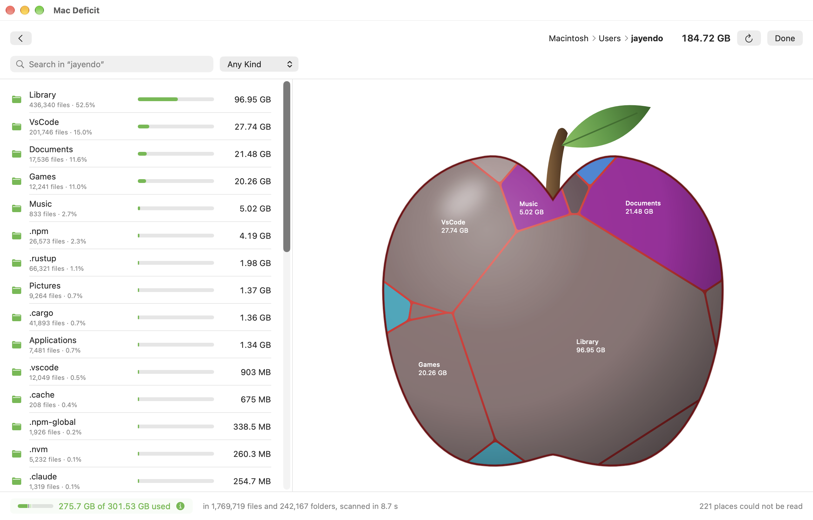
*A home folder drawn as an apple: each cell a folder, coloured by the kind of file that fills it, beside the list largest first.*

  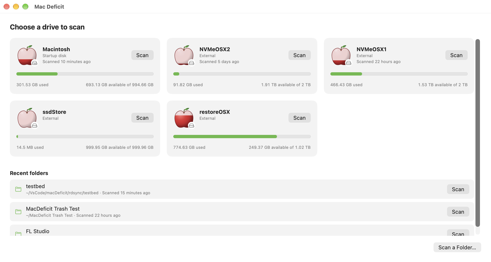
  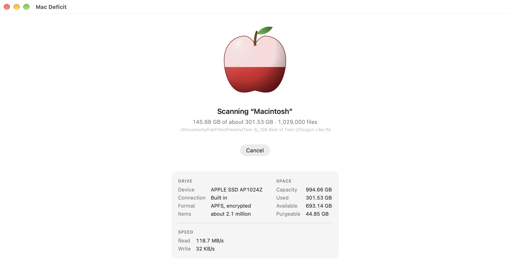

  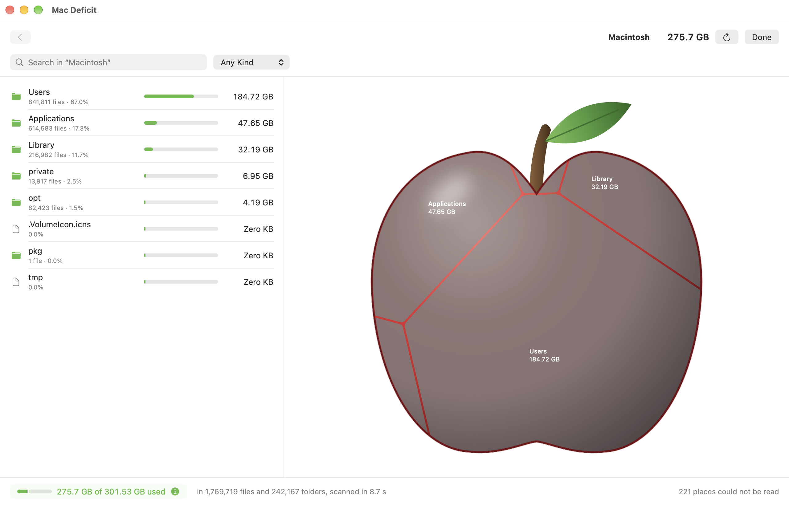
  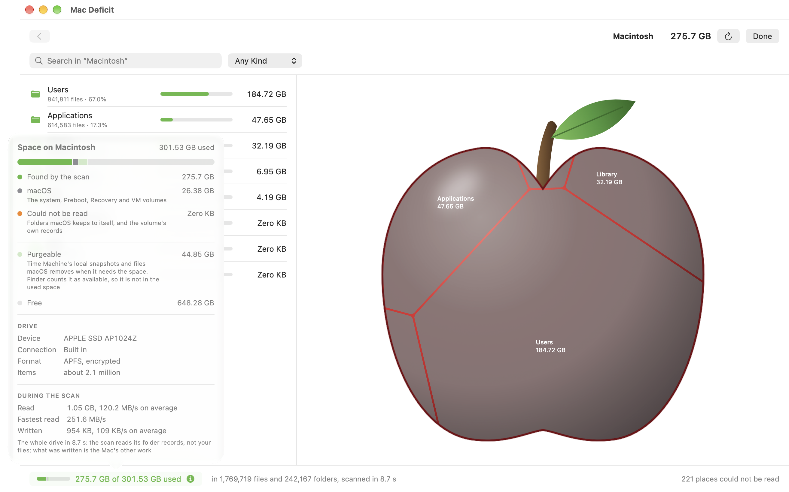

*Your drives as apples; a scan with the drive's own details and speed; a whole startup disk in 8.7 seconds; and where its used space went.*

  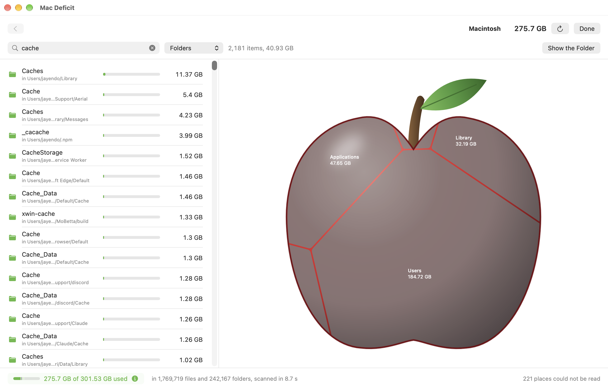
  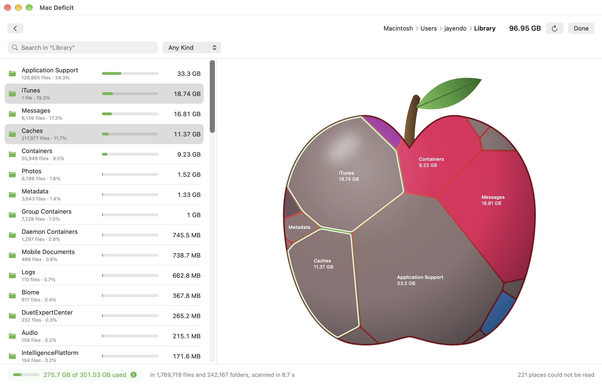

  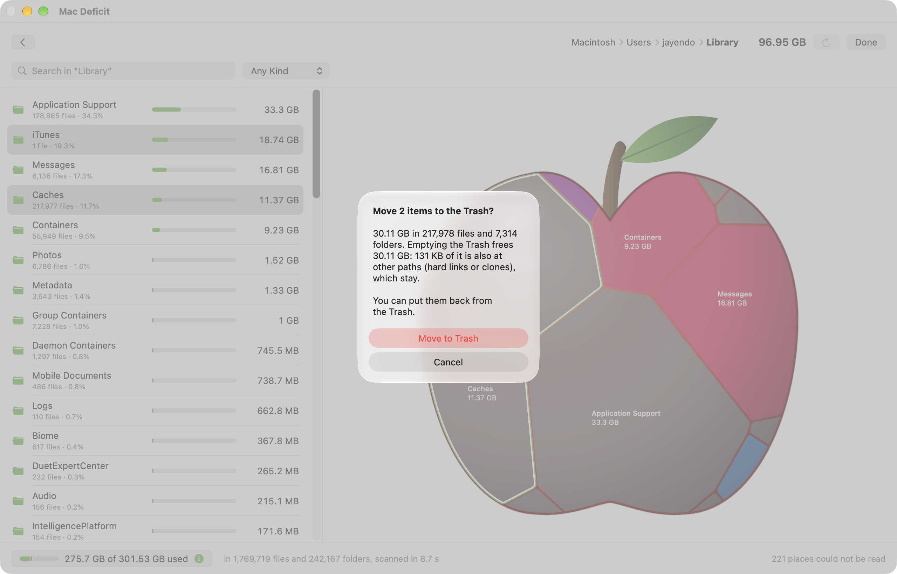
  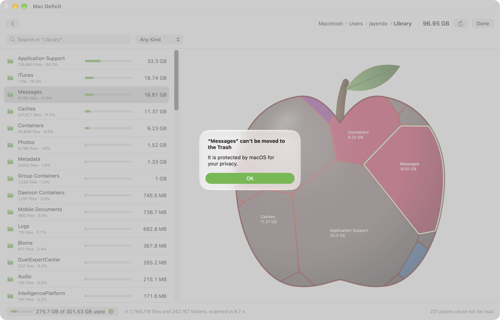

  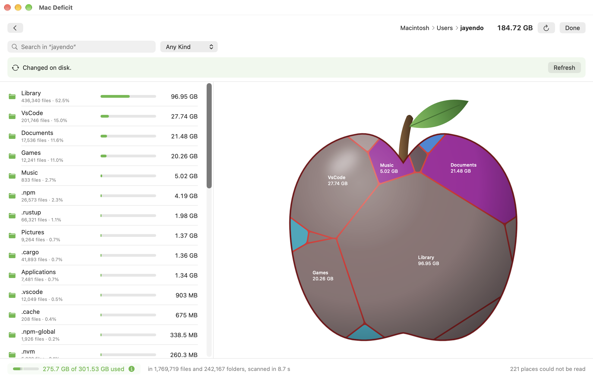
  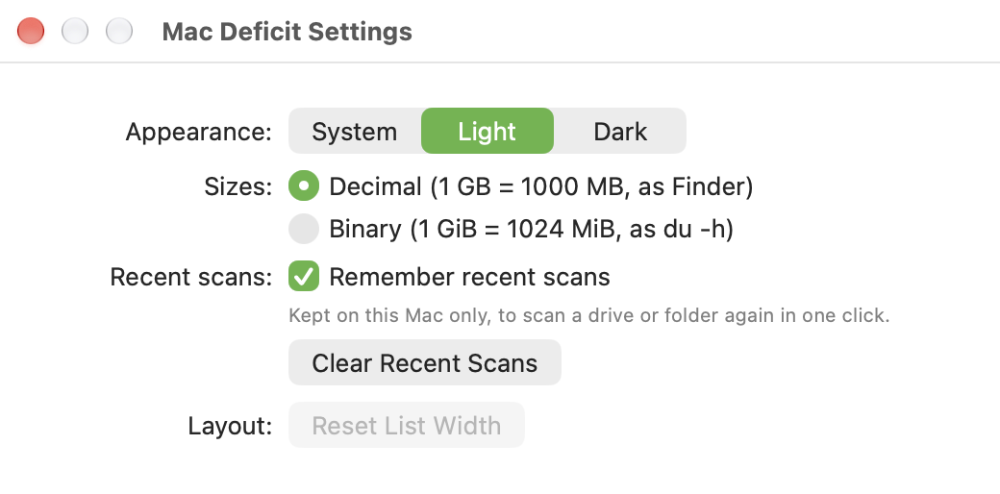

*Search anywhere below a folder; several things chosen at once and moved to the Trash with their total first; a private folder refused with the reason; a change made in Finder noticed; and Settings. November 2026, work in progress.*

## Roadmap
| Phase | Status |
| --- | --- |
| Foundations | Complete · December 2025 |
| The Scanner | Complete · December 2025 |
| Seeing Your Drive | Complete · December 2025 |
| The Apple Treemap | Complete · November 2026: a real-looking apple filled with cells, the biggest in its body, tapering to the tip; the drives shown as apples |
| Audit and Overhaul | Complete · November 2026: scanner rebuilt (4× faster, half the memory), one native Mac app with its Apple Treemap, checked with VoiceOver, and its own icon: an apple ripening from gold to red |
| Clearing Space (Trash, Reveal in Finder) | Complete · November 2026: Reveal in Finder, Move to Trash with its size first and Put Back, several things at once, Delete Immediately, changes made in Finder noticed with one-click Refresh, and everything macOS protects for your privacy kept safe |
| Polish and Release | Under way · November 2026: drives that come and go, settings, search, where a drive's space went, drive details while scanning, and an App Store edition; a code review and cleanup before release; a signed, notarized app next |

## Get Involved
- **Questions, ideas, or just want to say hi?** Start a thread in [Discussions](../../discussions).
- **Feedback on something you've seen?** Open an [issue](../../issues/new/choose).
- **Follow along** at [rawdata.cloud](https://rawdata.cloud).
